# Manual del usuario — NovaPop

NovaPop es una plataforma de streaming de películas y series. Esta guía explica, paso a paso, cómo usarla.

**Dirección:** https://novapop.onrender.com
*(La primera vez puede tardar unos segundos en abrir, porque el servidor gratuito se "despierta".)*

---

## Índice

1. [Crear una cuenta](#1-crear-una-cuenta)
2. [Iniciar sesión](#2-iniciar-sesión)
3. [Perfiles](#3-perfiles)
4. [Explorar el catálogo](#4-explorar-el-catálogo)
5. [Ver un título](#5-ver-un-título)
6. [Ver una película o serie](#6-ver-una-película-o-serie)
7. [Mi cuenta](#7-mi-cuenta)
8. [Instalar NovaPop como app](#8-instalar-novapop-como-app)
9. [Tema claro u oscuro](#9-tema-claro-u-oscuro)

---

## 1. Crear una cuenta

En la página de inicio, pulsa **Crear mi cuenta**.

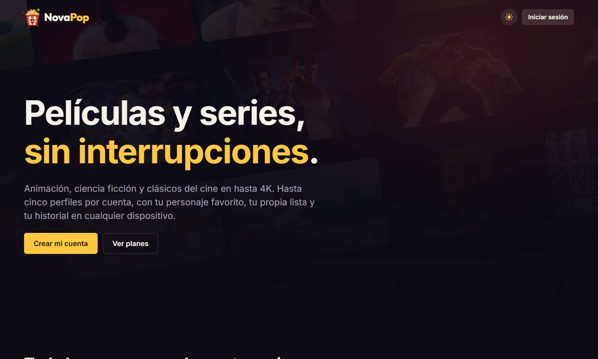

Completa el formulario: correo, contraseña, país, plan y un método de pago (es una simulación, no se cobra nada).

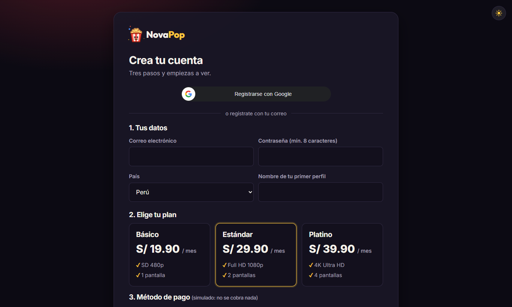

> También puedes registrarte con **Continuar con Google**: NovaPop toma tu correo de Google y solo te pide elegir el
> país, el plan y el método de pago.

## 2. Iniciar sesión

Pulsa **Iniciar sesión**, escribe tu correo y contraseña, y pulsa **Entrar**. O usa **Continuar con Google**.

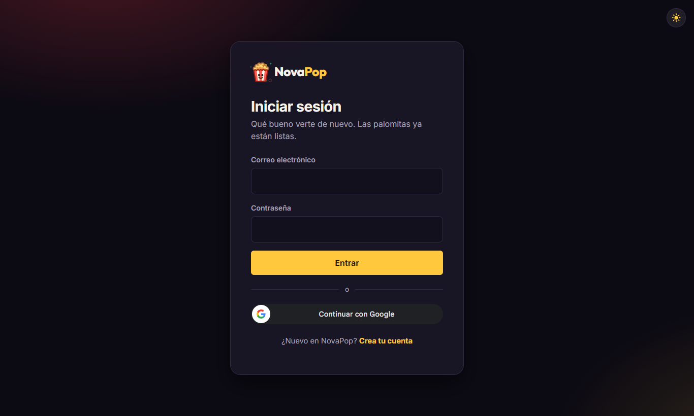

## 3. Perfiles

Una cuenta puede tener hasta **5 perfiles** (por ejemplo, uno por cada miembro de la familia). Al entrar, elige quién
está viendo.

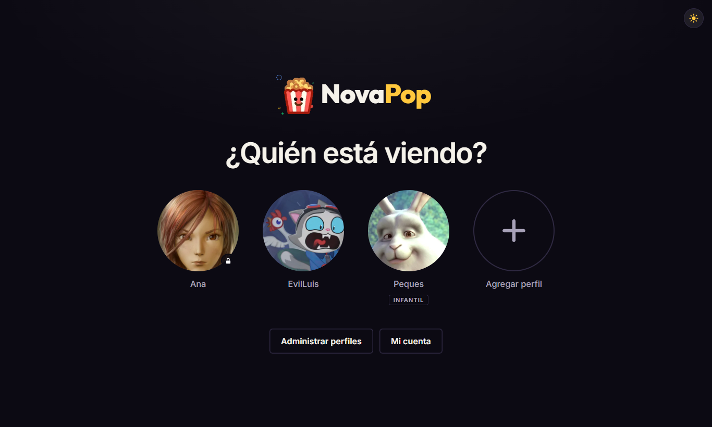

### Crear o editar un perfil

Pulsa **Administrar perfiles** y luego un perfil (o **Agregar perfil**).

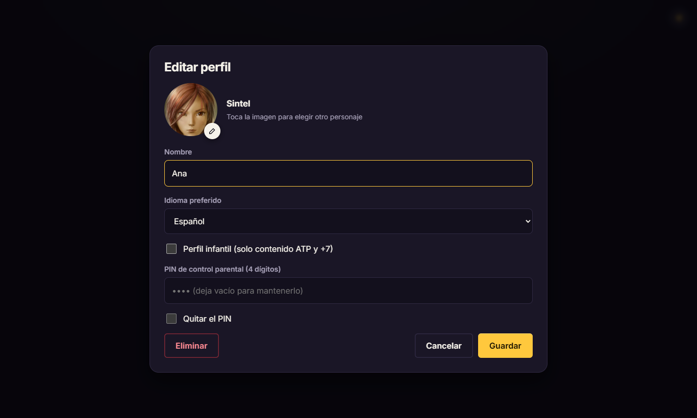

- **Personaje:** toca la imagen para elegir un personaje de las películas y series (Marvel, DC, Disney y más).
- **Perfil infantil:** solo muestra contenido apto (hasta +7). Úsalo para los niños.
- **PIN:** un código de 4 dígitos para proteger el perfil. Al entrar, pedirá ese PIN.

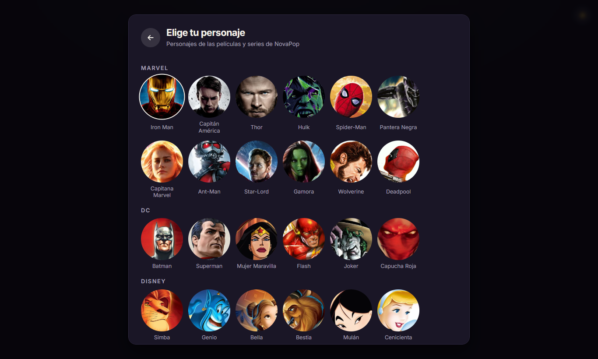

## 4. Explorar el catálogo

La pantalla de inicio muestra un título destacado arriba (usa las flechas ‹ › para ver otros) y filas con el catálogo:
Top 10, Seguir viendo, Mi lista y colecciones por tema.

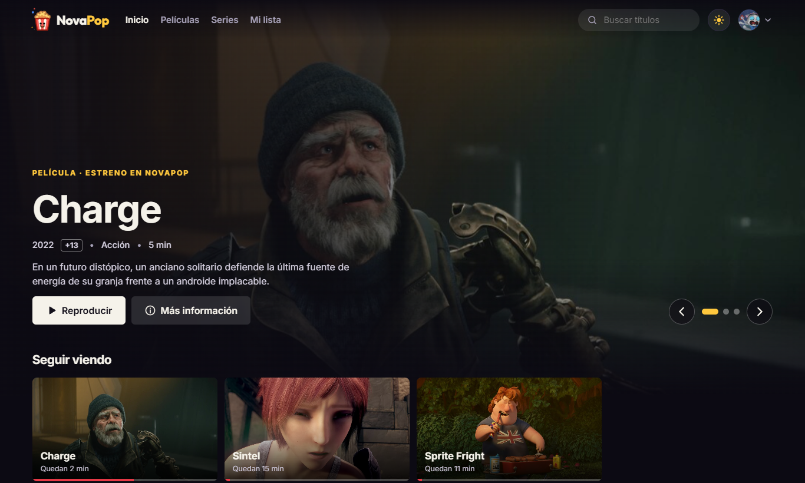

- **Buscar:** escribe en la barra de búsqueda de arriba.
- **Películas / Series / Mi lista:** los enlaces del menú superior.

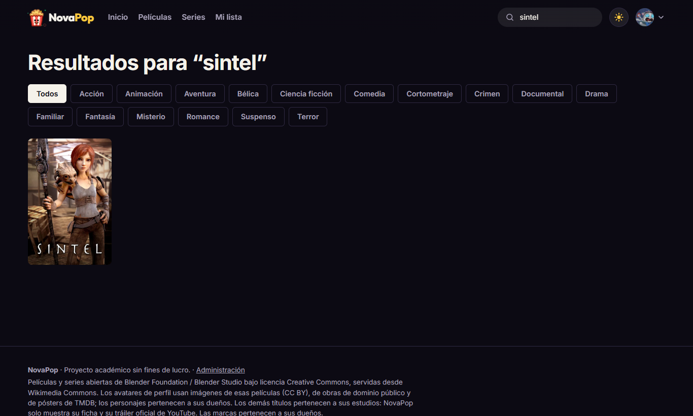

## 5. Ver un título

Al abrir una película o serie verás su sinopsis, duración, clasificación por edad, elenco y el botón **Reproducir**
(o **Ver tráiler** si es un título que solo tiene tráiler).

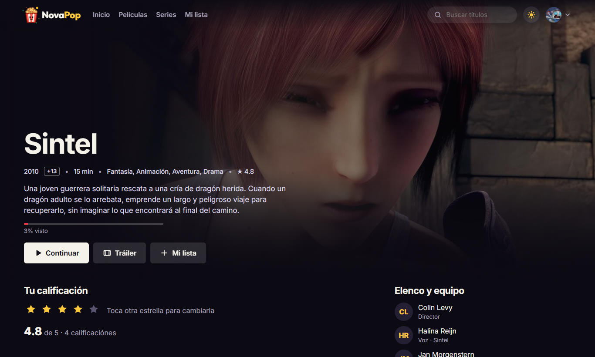

- **+ Mi lista:** la guarda para verla después.
- **Calificar:** toca las estrellas.
- **Elenco:** toca un actor o director para ver **su filmografía** — sus otros títulos en NovaPop y el resto de su
  carrera.

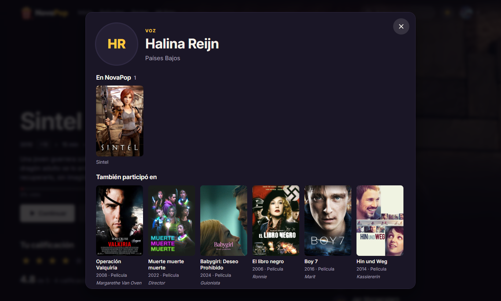

## 6. Ver una película o serie

Pulsa **Reproducir**. El reproductor recuerda dónde te quedaste y puedes elegir la calidad y los subtítulos según tu plan.

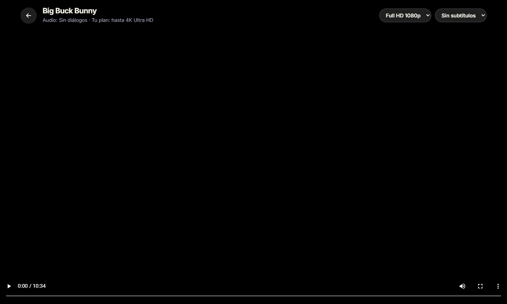

## 7. Mi cuenta

Desde el menú de tu perfil (arriba a la derecha) → **Mi cuenta**. Ahí puedes:

- cambiar de **plan** y activar o desactivar la renovación automática;
- administrar tus **métodos de pago** y ver tu **historial de pagos**;
- ver y quitar los **dispositivos** donde iniciaste sesión;
- **Descargar mis datos:** un archivo con toda tu información (cuenta, perfiles, historial, lista y calificaciones).

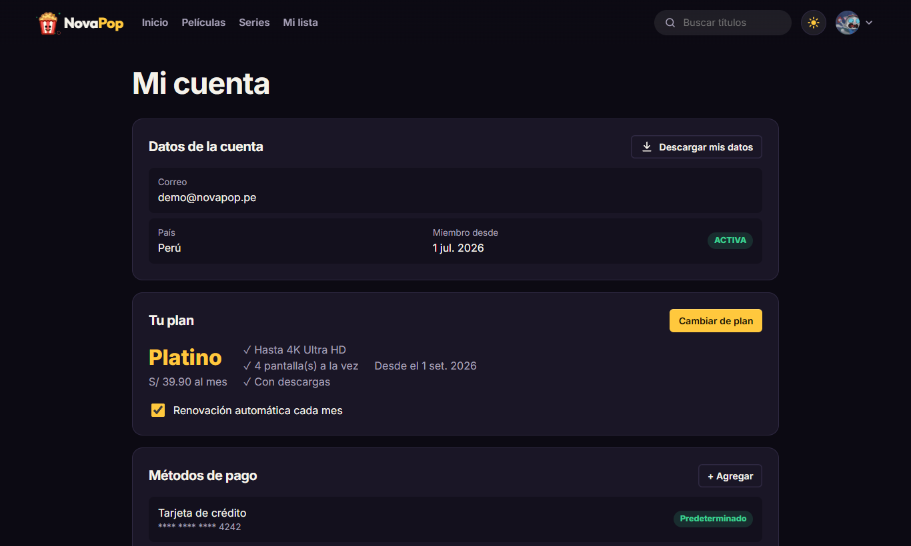

Desde ese mismo menú también puedes **Cambiar personaje**, **Cambiar de perfil** o **Cerrar sesión**.

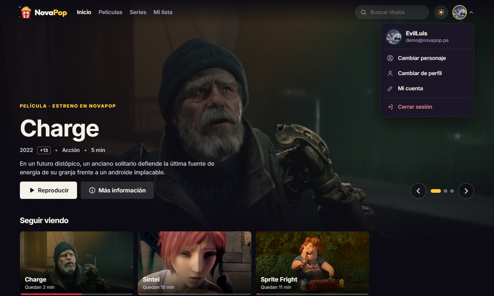

## 8. Instalar NovaPop como app

NovaPop es una **PWA**: se puede instalar como una app en el celular o la computadora.

- **En la computadora (Chrome/Edge):** aparece un ícono de instalar en la barra de direcciones, o usa el botón
  **Instalar app** del menú de perfil.
- **En el celular:** el navegador ofrece "Agregar a la pantalla de inicio".

Una vez instalada, se abre en su propia ventana, con el ícono de las palomitas. Si te quedas sin internet, muestra una
página propia que avisa que estás sin conexión.

## 9. Tema claro u oscuro

El botón con el sol/luna (arriba a la derecha) cambia entre el tema oscuro y el claro. NovaPop recuerda tu elección.
